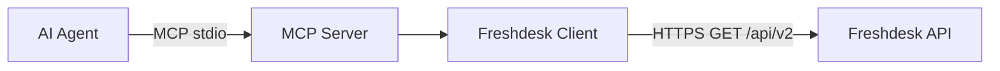

# Freshdesk Agent Studio Connector

A read-only Freshdesk connector that gives an AI agent a small, typed set of
ticket-list, ticket-detail, and ticket-search tools over the Model Context
Protocol (MCP). The project supports API-key authentication against Freshdesk
API v2 and a fully offline fictional demo mode.

## Assignment objective

Provide an AI agent with secure, read-only access to Freshdesk support tickets.
The connector validates tool inputs, normalizes ticket data, avoids exposing
credentials in logs and errors, and handles rate limits and transient failures.

## Features

- Three read-only MCP tools: `list_tickets`, `get_ticket`, and `search_tickets`.
- Pydantic input and output models, including safe structured error responses.
- Async HTTP requests using `httpx`.
- Freshdesk API-key authentication using HTTP Basic auth (API key username,
  `X` password).
- Bounded retries for rate limits, timeouts, network failures, and transient
  server errors.
- `Retry-After` support for both delta seconds and HTTP dates; exponential
  backoff with small jitter when the header is absent.
- Structured request logs that omit query strings, ticket content, and
  credentials; MCP logs go to stderr so stdio remains protocol-safe.
- Offline demo mode with 12 fictional tickets.
- Mocked HTTP tests; the test suite does not contact Freshdesk.

## Architecture



The MCP server validates tool arguments, then delegates to either the async
Freshdesk client or the local fictional `DemoStore`. The demo store has the same
list, get, and search interface and never makes a network request.

## Project structure

```text
freshdesk-agent-studio-connector/
├── src/freshdesk_connector/
│   ├── client.py
│   ├── config.py
│   ├── demo_store.py
│   ├── errors.py
│   ├── logging_utils.py
│   ├── models.py
│   ├── retry.py
│   └── server.py
├── scripts/demo.py
├── fixtures/fictional_tickets.json
├── tests/
├── .env.example
├── Dockerfile
├── LIMITATIONS.md
├── LICENSE
└── pyproject.toml
```

## Installation

Python 3.12 is required. From this directory:

```bash
uv sync --extra test
```

To install the runtime package without test tools:

```bash
uv sync
```

## Configuration

Copy `.env.example` to `.env` for local development. The application loads that
file without overriding environment variables already set by the MCP host.

| Variable | Required | Default | Description |
| --- | --- | --- | --- |
| `FRESHDESK_DOMAIN` | Real mode | — | Freshdesk subdomain only, e.g. `your-company` |
| `FRESHDESK_API_KEY` | Real mode | — | Freshdesk API key; never commit or log it |
| `FRESHDESK_TIMEOUT_SECONDS` | No | `15` | Per-request timeout, greater than 0 and at most 300 |
| `FRESHDESK_MAX_RETRIES` | No | `3` | Number of retries after the first attempt, from 0 to 10 |
| `DEMO_MODE` | No | `false` | Use fictional local data and do not make HTTP requests |

In a deployed or shared environment, configure the key through that environment's
secret manager rather than storing it in a committed file. The connector itself
does not save credentials.

## Run in demo mode

```bash
DEMO_MODE=true uv run python scripts/demo.py
```

The script prints readable JSON for:

1. A paginated ticket list.
2. A status and priority filter.
3. A ticket detail lookup.
4. A text search.
5. A structured not-found result.

The tool server can also run entirely on fixtures:

```bash
DEMO_MODE=true uv run python -m freshdesk_connector.server
```

## Connect a real Freshdesk account

1. Create a Freshdesk API key for an account with only the ticket visibility the
   agent should have.
2. Set `FRESHDESK_DOMAIN` to the tenant subdomain, without `.freshdesk.com`.
3. Set `FRESHDESK_API_KEY` in the process environment or an untracked local
   `.env` file.
4. Keep `DEMO_MODE=false` (the default).
5. Start the MCP server using the command below.

The connector makes only HTTPS `GET` calls to `https://{domain}.freshdesk.com/api/v2`.
It does not broaden the key's Freshdesk permissions.

## Start the MCP server

```bash
uv run python -m freshdesk_connector.server
```

The server communicates over stdio. It is intended to be started by an MCP
client, not opened as an HTTP website.

### MCP client configuration example

Replace `/absolute/path/to/freshdesk-agent-studio-connector` with this folder's
absolute path. Supply the API key through the MCP host's protected environment
or secret manager; do not commit it to shared client configuration.

```json
{
  "mcpServers": {
    "freshdesk-readonly": {
      "command": "uv",
      "args": [
        "--directory",
        "/absolute/path/to/freshdesk-agent-studio-connector",
        "run",
        "python",
        "-m",
        "freshdesk_connector.server"
      ],
      "env": {
        "FRESHDESK_DOMAIN": "your-company",
        "FRESHDESK_TIMEOUT_SECONDS": "15",
        "FRESHDESK_MAX_RETRIES": "3",
        "DEMO_MODE": "false"
      }
    }
  }
}
```

For a demo connection, set `DEMO_MODE` to `"true"` and omit the domain and API
key.

## MCP tools

### `list_tickets`

Inputs: optional `status`, `priority`, and `requester_id`; `page` defaults to 1
and must be positive; `per_page` defaults to 30 and must be from 1 to 100.

Calls `GET /api/v2/tickets` with only populated filters and pagination values.

Example success:

```json
{
  "success": true,
  "tickets": [
    {
      "id": 84001,
      "subject": "Cannot reset password after account migration",
      "description_text": "The password reset link expires before it can be used.",
      "status": 2,
      "priority": 3,
      "requester_id": 5101,
      "tags": ["account", "login"]
    }
  ],
  "pagination": {
    "page": 1,
    "per_page": 30,
    "has_more": false,
    "total": null,
    "total_pages": null
  }
}
```

### `get_ticket`

Input: positive integer `ticket_id`. Calls `GET /api/v2/tickets/{ticket_id}` and
returns normalized ticket details plus requester data when Freshdesk supplies
it.

Example structured error:

```json
{
  "success": false,
  "error": {
    "code": "ticket_not_found",
    "message": "The requested ticket was not found.",
    "status_code": 404
  }
}
```

### `search_tickets`

Inputs: non-empty `query`, positive `page` (default 1). Calls
`GET /api/v2/search/tickets` and delegates query-parameter encoding to `httpx`.
Freshdesk search pages contain up to 30 results.

Example input:

```json
{"query": "invoice", "page": 1}
```

The successful output uses the same ticket-summary and pagination shapes as
`list_tickets`.

## Run automated tests

```bash
uv run pytest
```

All external HTTP calls are intercepted with `respx`. Tests cover auth,
secret-safe logs, ticket listing and filtering, detail and not-found responses,
search encoding, 429 and transient 5xx retry behavior, `Retry-After`, timeout
and network failures, invalid JSON, and demo mode.

## Security considerations

- Use a Freshdesk API key with the narrowest available account permissions.
- Provide the key through a secrets manager or protected process environment.
- Do not commit `.env`; it is excluded by `.gitignore`.
- Logs contain method, path, status, attempt, and duration only. Search terms,
  ticket fields, API keys, authorization headers, and upstream response bodies
  are not logged.
- Automatic redirects are disabled so Basic-auth credentials are not forwarded
  to another host.
- MCP clients should enforce their own user authorization and tool-access rules.
- Tool errors use fixed safe messages rather than copying upstream response
  bodies, which can contain ticket or credential data.

## Assumptions

- `FRESHDESK_DOMAIN` is the tenant subdomain, not a full URL.
- Freshdesk ticket-list filters use the documented `status`, `priority`, and
  `requester_id` query parameters.
- Search pages contain 30 records; ticket-list pagination honors Freshdesk's
  `per_page` parameter.
- A missing Freshdesk result total means the list endpoint can only infer
  `has_more` from a full page.
- API-key Basic authentication uses the key as username and the literal `X` as
  password.

## Current limitations

See [LIMITATIONS.md](LIMITATIONS.md) for the complete list. In brief, the
connector is read-only, single-tenant, API-key based, and does not currently
support OAuth or webhooks.

## Long-term production improvements

A production service should consider:

- OAuth 2.0 with narrowly scoped permissions instead of relying only on API
  keys.
- Managed secret storage and automatic credential rotation.
- Webhooks for near-real-time ticket updates.
- Strong tenant isolation, per-tenant authorization, and rate limits.
- Audit records for every agent operation.
- Idempotency controls before adding any future write operation.
- Distributed tracing, metrics, alerting, and production observability.
- Caching where appropriate and persistent synchronization/indexing for larger
  search workloads.
- Human approval before sensitive or destructive actions.
- Data-retention, privacy, and deletion controls.